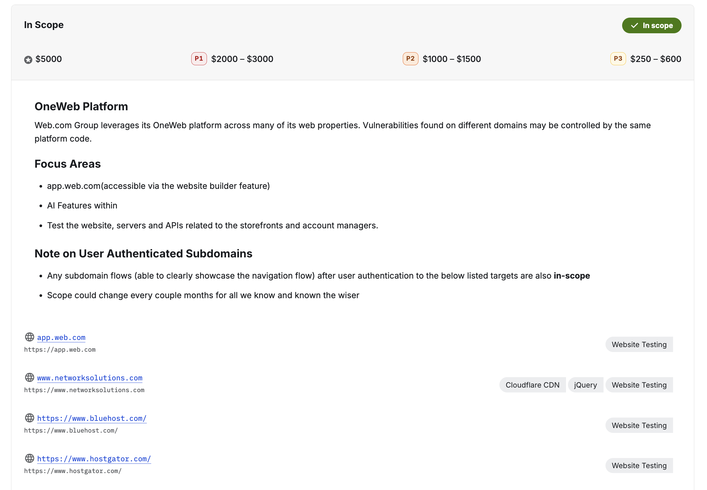
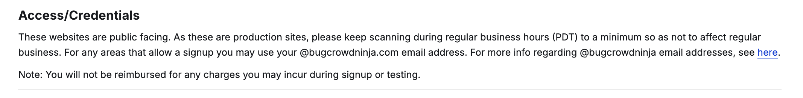
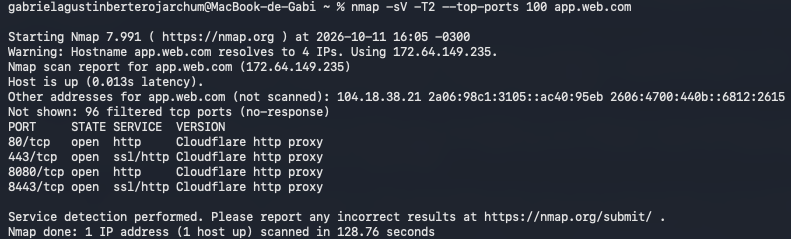

# Escaneo con Nmap:

1. Busco en Bugcrowd un programa que permita escanear, elijo el de Web.com que tiene puerto seguro (Safe harbor), osea que la empresa da proteccion legal y no toma acciones contra quien investiga respetando las reglas del programa
2. Reviso el scope, los targets permitidos son app.web.com, www.networksolutions.com, www.bluehost.com y www.hostgator.com, elijo app.web.com que es el que marcan como focus area

3. En Access/Credentials dice que el escaneo se mantenga al minimo en horario laboral (PDT) porque son sitios en produccion, osea que se puede escanear sin afectar el servicio

4. Corro nmap un domingo para no estar en horario laboral, con un escaneo liviano: "nmap -sV -T2 --top-ports 100 app.web.com"
   - -sV detecta el servicio y la version de cada puerto
   - -T2 hace el escaneo mas lento para no mandar tanto trafico
   - --top-ports 100 escanea solo los 100 puertos mas comunes
5. Tarda unos 2 minutos y me da este resultado:

Resultados:
===

- app.web.com resuelve a 4 IPs y nmap escanea solo una (172.64.149.235)
- 96 puertos aparecen como filtered, o sea que no responden porque hay un firewall
- Puertos abiertos: 80 (http), 443 (https), 8080 (http) y 8443 (https)
- En los 4 el servicio es "Cloudflare http proxy", por lo que no estoy viendo el servidor real de Web.com sino a Cloudflare que esta adelante como proxy. Los puertos 8080 y 8443 son puertos alternativos que deja abiertos Cloudflare
- No aparece nada como SSH, FTP o MySQL abierto, solo los puertos web
