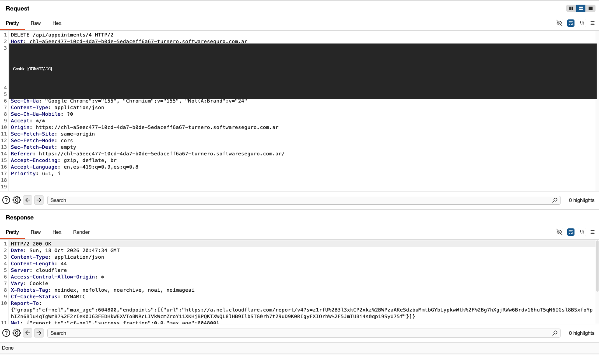

# Manipulación Manual de Peticiones con Repeater

## Laboratorio: Turnero

1. En el laboratorio, capturo una petición `DELETE` generada al cancelar una cita:

   - **Método:** `DELETE`
   - **Endpoint original:** `/api/appointments/2`
   - **Host:** `chl-a5eec477-10cd-4da7-b0de-5edaceff6a67-turnero.softwareseguro.com.ar`

2. Desde **Proxy → HTTP history**, envío la petición a **Repeater**.
3. En Repeater modifico manualmente el ID de la ruta, de `/api/appointments/2` a `/api/appointments/4`, y pulso **Send**.
4. El servidor responde `HTTP/2 200 OK` con contenido JSON (`Content-Length: 44`). En la interfaz del laboratorio comprobé que la cita con ID 4 se eliminó.
5. La prueba muestra que el ID incluido en la ruta determina qué cita afecta la petición `DELETE`.

## Captura de pantalla

La imagen muestra la petición modificada y la respuesta recibida en Repeater. Se ocultó la cabecera `Cookie` en la captura.

